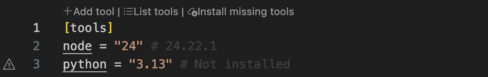
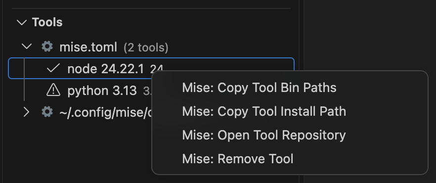
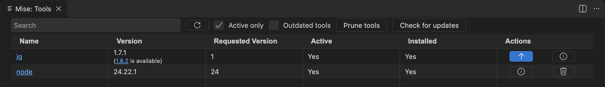

## Tools versions

The extension will show the currently installed tool versions directly in the
editor



Hovering a tool in a config file shows its backend, its description and its
versions. The hover also links to:

- the website of the project, when the
  [registry](https://mise.jdx.dev/registry.html) has one
- the release notes of the latest version, when a newer version is available
  and its backend publishes them (e.g. GitHub releases)

## Tool explorer (activity bar)

The tool explorer in the activity bar allows you to quickly which tools are used
in the current project. You can also the list of global tools.

- Click on a tool to navigate to the file where it is defined
- Some additional options are available on right-click, like copying the
  bin/install path or removing the tool



The `+` button of the explorer adds a tool to a config file with `mise use`.
Pick a tool from the registry, or type `npm:`, `cargo:`, `gem:` or `dotnet:`
followed by a name to search the npm, crates.io, RubyGems or NuGet packages
(mise 2026.9.13+).

A config file that does not parse is marked in the explorer. Its tools are the
ones from the last time the file parsed. See [While a config file is being edited](/mise-vscode/reference/misetoml-language-support/#while-a-config-file-is-being-edited).

### Lazy tools

Tools declared with `lazy = true` are installed by mise the first time one of
their commands runs. Until then, they are not reported as missing: the explorer
and the editor show them as `installs on first use` instead of not installed.
The extensions configured with the path of a tool (see
[supported extensions](/mise-vscode/reference/supported-extensions/)) only pick
it up once it is installed.

```toml
[tools]
ripgrep = { version = "14", lazy = true }
```

## Tools list

Use the list `List all tools` button to list all installed tools.

- You can filter the tools used in the current project using `active` only.
- From there, you can upgrade, uninstall or prune unused tools
- When a newer version is available, it links to its release notes, for the
  backends that publish them


