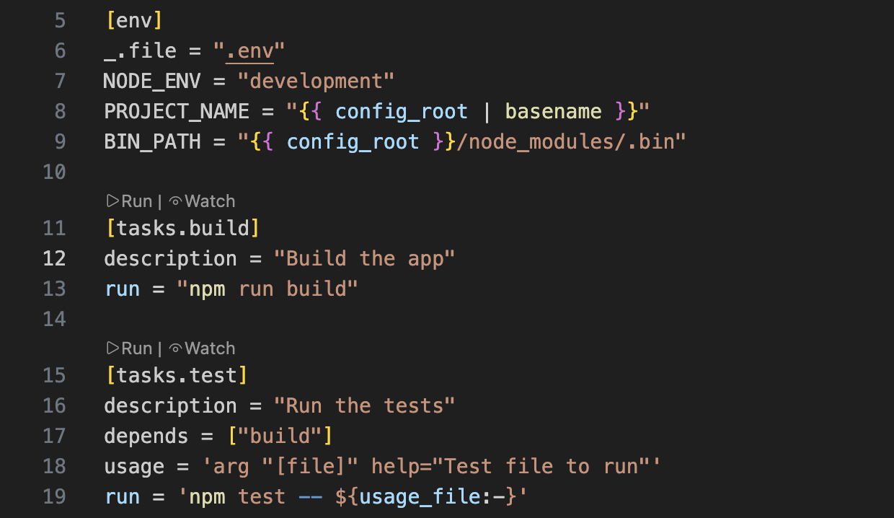
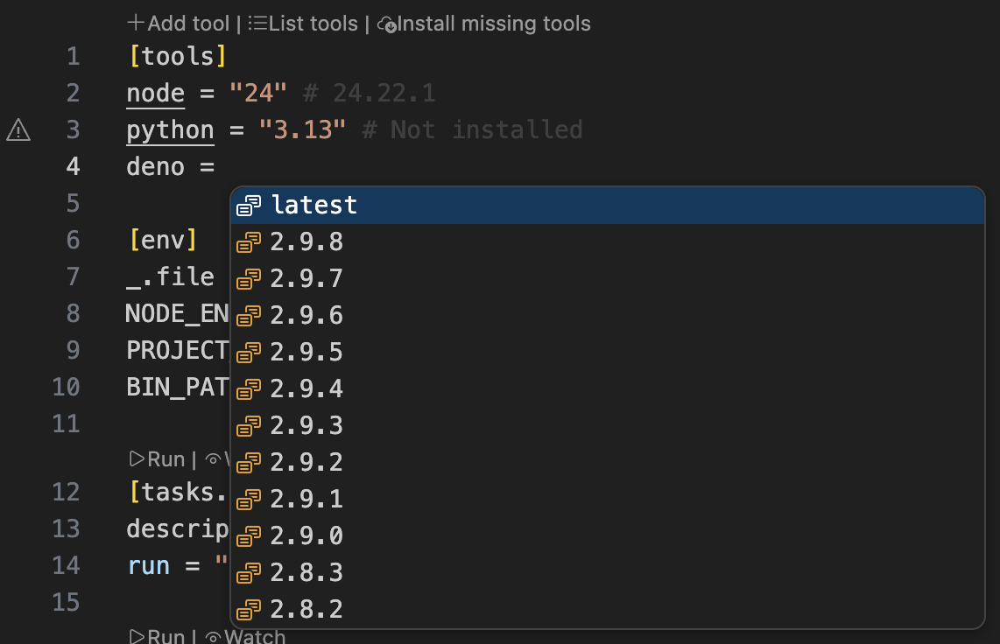
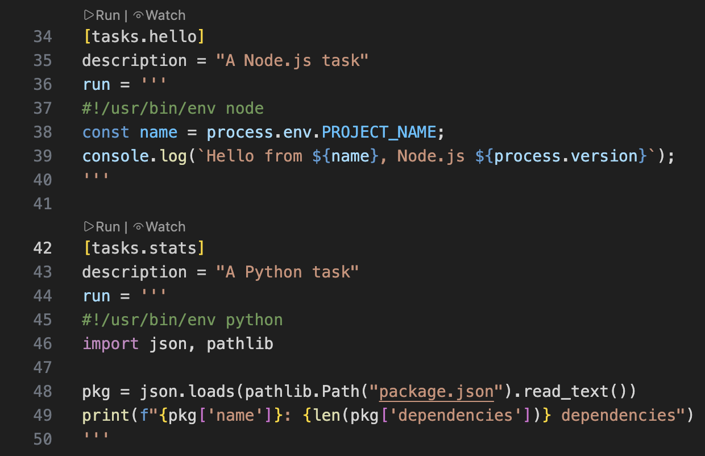

### Syntax Highlighting for TOML

This extension provides basic syntax highlighting for `mise.toml/mise.lock` files.
For the best experience with autocompletion and validation in `mise.toml` files, you should install the
[Tombi TOML](https://marketplace.visualstudio.com/items?itemName=tombi-toml.tombi) extension.

Tombi uses the [JSON Schema Store](https://www.schemastore.org) catalog by default,
which associates the [mise JSON schema](https://mise.jdx.dev/schema/mise.json)
with all mise configuration files, including environment and platform-specific
ones such as `mise.local.toml`, `mise.linux.toml`, or `mise/config.macos-arm64.toml`
(see [`auto_env`](https://mise.jdx.dev/configuration/environments.html)), so
autocompletion and validation work in all of them.

`mise-vscode` provides syntax highlighting for `tera` used for
[templating](https://mise.jdx.dev/templates.html) in `mise.toml` files.
Task scripts are highlighted as shell, whether `run` is a string or an array
of scripts, and `usage` specs as KDL, also when the TOML highlighting comes
from Tombi.

:::note
Tombi's semantic highlighting colors every TOML string, and VS Code draws it
over the shell highlighting. With Tombi, one-line scripts (and the first line
of multi-line ones) only get shell colors when Tombi does not send semantic
tokens for strings. Turn them off in your settings (requires Tombi 1.9.0 or
later); strings keep their color, and the extension offers to do it the first
time you open a mise config file:

```json
"tombi.semanticTokens.strings.enabled": false
```

With older versions of Tombi, turn off semantic highlighting for TOML files.
This also drops Tombi's semantic colors for keys and tables:

```json
"[toml]": { "editor.semanticHighlighting.enabled": false }
```
:::



#### tasks_config.includes

If you use [`tasks_config.includes`](https://mise.jdx.dev/tasks/task-configuration.html#task-config-includes) to include some additional tasks files, add the following at the top of your file to get auto-completion and validation from Tombi.

```toml
#:schema https://mise.jdx.dev/schema/mise-task.json

[build]
run = "echo Hello, World!"
```

#### Autocompletion for tools 

Tool names and versions are autocompleted in the `tools` section of a `mise.toml` file.
Press `Ctrl+Space` (or click the arrow) on a tool name suggestion to see the
description of the tool from the mise registry, in `.tool-versions` files too.



In `.tool-versions` files, backend prefixes (`core:`, `npm:`, `cargo:`, ...) are
also autocompleted, and typing a prefix such as `core:` suggests the registry
tools of that backend (e.g. `core:node`).

### Tool stubs

[Tool stubs](https://mise.jdx.dev/dev-tools/tool-stubs.html) are executable
files (usually committed under `bin/`) whose body is TOML under a
`#!/usr/bin/env -S mise tool-stub` shebang:

```toml
#!/usr/bin/env -S mise tool-stub

version = "2.96.0"
tool = "github:cli/cli"
bin = "bin/gh"
```

The extension detects the shebang and opens stub files as TOML, so they get
syntax highlighting even though they have no `.toml` extension.

#### Autocompletion for tasks

Code completion is provided for `depends = ["task_name"]`, `depends_post = ["task_name"]`, `wait_for = ["task_name"]`.

`extends = "template_name"` completes the
[task templates](https://mise.jdx.dev/tasks/templates.html) declared in the file
being edited and in its parent config files. See the
[task templates section](/mise-vscode/reference/tasks/#task-templates) of the tasks
reference for the hover, go-to-definition, and find-references support.

#### Autocompletion for daemons

The names of [daemons](/mise-vscode/reference/daemons/) are completed where a
value refers to them: the `daemons` of a task, the `depends` of a daemon, and
the members of a `[daemon_groups]` group (which can also name other groups).
`preset = "..."` completes the
[service presets](https://mise.jdx.dev/daemons/presets.html) of mise, and
`task = "..."` the task a daemon runs. In a `pitchfork.toml`, the same goes for
the `depends` of a daemon and the members of a `[groups.<name>]` group.

Hovering a daemon name shows its status, with actions to start, stop or
restart it and to show its logs, and Cmd/Ctrl+Click goes to its declaration.

#### Autocompletion for templates

Inside `{{ ... }}` and ``, the extension completes the
[variables, functions, filters and tests](https://mise.jdx.dev/templates.html)
of mise's Tera 2 engine: variables and functions such as `config_source`,
`system_brew_prefix`, `read_json()` or `libc()`, filters after `|`, and tests
after `is` (such as `is starting_with(pat="mac")`). Hovering one explains it.

The Tera v1 helpers that mise deprecates, such as `as_str` or `map`, are not
suggested. Hovering one shows what replaces it, before mise 2027.4.0 removes it.
Set `mise.teraAutoCompletion` to `false` to turn completion and hover off.

### Task arguments (usage spec)

Task arguments are declared with the
[`usage` field](https://mise.jdx.dev/tasks/task-arguments.html) of a task,
using the [usage spec](https://usage.jdx.dev/spec/). The extension provides:

- **Syntax highlighting** of `usage = '''...'''` blocks (KDL)
- **Context-aware autocompletion**: directives (`arg`, `flag`, `complete`) at
  the start of a line, the attributes valid for that directive after it
  (`help`, `default`, `choices` blocks, `count`, `negate`, ...), without
  repeating attributes that are already set
- **Hover documentation** for directives and attributes
- **`$usage_*` variable completion**: typing `$` in a multiline `run` block
  suggests the `usage_*` environment variables derived from the args and
  flags of that task. `cmd|ctrl+click` on a `$usage_*` variable goes to the
  arg or flag declaring it, and hovering it shows the declaration

```toml
[tasks.deploy]
usage = '''
arg "<environment>" help="Target environment" {
  choices "dev" "staging" "prod"
}
flag "-v --verbose" help="Enable verbose output"
'''
run = '''
echo "Deploying to ${usage_environment?}"
'''
```

#### File tasks

The same support is available in shell
[file tasks](https://mise.jdx.dev/tasks/file-tasks.html):

- `#USAGE` lines get usage spec syntax highlighting, autocompletion, and hover
- `#MISE` lines are highlighted as TOML, with autocompletion and hover for the
  [task configuration keys](https://mise.jdx.dev/tasks/task-configuration.html)
  (`description`, `alias`, `depends`, `sources`, `skip_if`, `vars`, the
  `deny_*`/`allow_*` sandbox keys, ...)
- `#MISE extends="template_name"` completes the
  [task templates](https://mise.jdx.dev/tasks/templates.html) declared in the
  config files above the script. `cmd|ctrl+click` on the name goes to the
  template, and hovering it shows the template
- Typing `$` in the script body suggests the `usage_*` variables from the
  `#USAGE` lines, and from the `usage` of the template the task extends
  (mise `2026.10.19` or later). `cmd|ctrl+click` and hover work on these
  variables as in TOML tasks

### Code lens features

This extension adds the following code lens features:

- Each task has a `run` and `watch` code lens that will run the task
- A `add tool` code lens that to automatically add a tool to a `mise.toml` file
- Lockfile code lenses on `mise.lock` and next to `[tools]`, see
  [Lockfile](/mise-vscode/reference/tools/#lockfile)
- Each daemon has its status and start/stop code lenses, see
  [Daemons](/mise-vscode/reference/daemons/#code-lenses)

### Code navigation

- Cmd/Ctrl+Click on an included file will open that file (example:
  `include = ["tasks.toml"`])
- Cmd/Ctrl+Click on `extends = "template_name"` opens the
  `[task_templates.template_name]` declaration; _Find all references_ on a
  declaration lists every task extending it
- Cmd/Ctrl+Click on a daemon name (`daemons = ["postgres"]` of a task,
  `depends` of a daemon, members of a group) opens its declaration

### Syntax highlighting for shebang

If you are using [multi-lines task script](https://mise.jdx.dev/tasks/toml-tasks.html#shell-shebang) with a shebang, syntax highlighting will be applied to the script.

The following languages are supported: Python, Node.js, Deno, Bun, Deno, Ruby, Bash, and Shell.



### Unknown and deprecated keys

The keys of a config file that mise does not read, e.g. a typo, are reported in
the Problems panel, with the key mise most likely meant and a quick fix to use
it. Deprecated keys are reported too, with what the schema says about them.

```toml
[settings]
experimantal = true # mise does not read `settings.experimantal`. Did you mean `experimental`?
```

This comes from
[`mise config explain`](https://mise.jdx.dev/cli/config/explain.html) (mise
2026.10.14+), which also reads a config file mise refuses to load, e.g. one with
an unknown task key. The extension checks the config files mise loads, those
of each [monorepo](https://mise.jdx.dev/tasks/monorepo.html) project, and any
other mise config file while it is open in an editor tab, e.g. in a subfolder.
Task files included with `task_config.includes` are left out. Turn it off with
`mise.enableConfigDiagnostics`.

Tombi and Even Better TOML check the same schema, and report some of these keys
themselves: a key one of them already reports only gets the quick fix.

### When a config file changes

The extension reloads when a file mise reads changes: the config files, the
files they merge with
[`include = [...]`](https://mise.jdx.dev/configuration.html#include), the task
files, the env files and the idiomatic version files (`.nvmrc`, ...). So do the
miserc files, which pick the environments mise loads: `.miserc.toml`,
`.miserc.local.toml` and `.config/miserc.toml` from the workspace up to the home
directory, and the global (`miserc.toml`, `miserc.local.toml`) and system ones.

Included files are found by reading the `include` of each config file. Only the
local ones are watched, `git::` and `oci::` includes are fetched by mise, and
paths using a template other than `{{ config_root }}` are not resolved.

### While a config file is being edited

With auto save enabled, a config file is written while you are still typing it.
mise cannot read a file that does not parse, so every command fails until it
does.

Instead of clearing the panels, the extension keeps showing the last state it
could read. The status bar shows a warning while this is the case, and config
files that do not parse are marked in the activity bar.

If a command never succeeded, its error is shown as usual. Opening a project
with a config file that is already broken shows errors.

Running or watching a task is refused while a config file does not parse. You
get a message pointing at the file, instead of a mise error about a task that
does not exist.

The kept state is dropped when:

- the file parses again
- you save it yourself with `Cmd`/`Ctrl`+`S`
- you reload the configuration from the activity bar, the status bar or the
  command palette

Reloads the extension does on its own, for example after running a task, do not
drop it. There is no timeout: the state is kept for as long as the file does not
parse.
